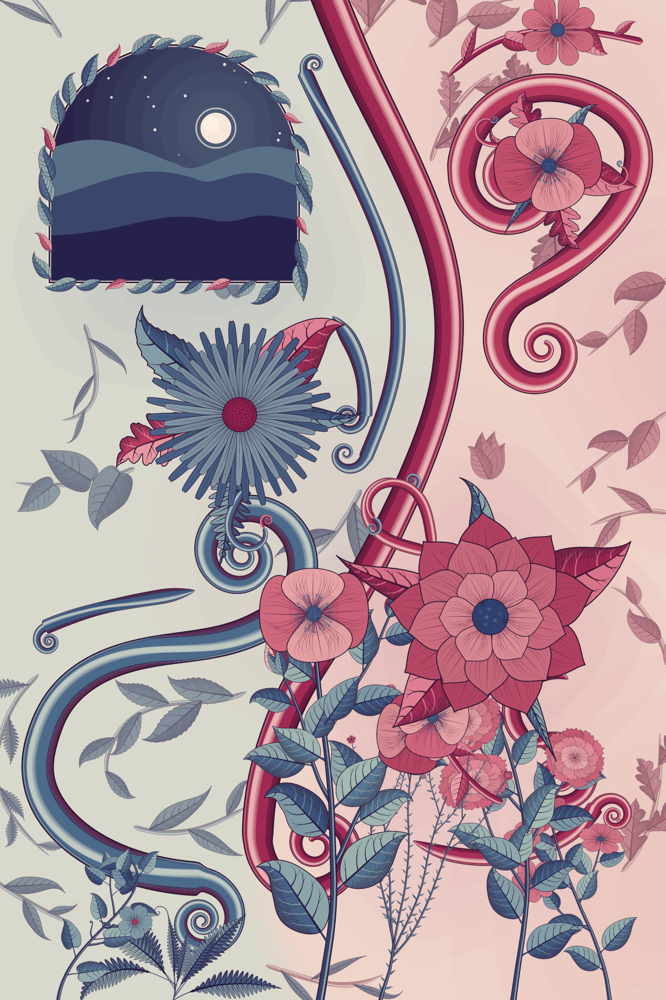
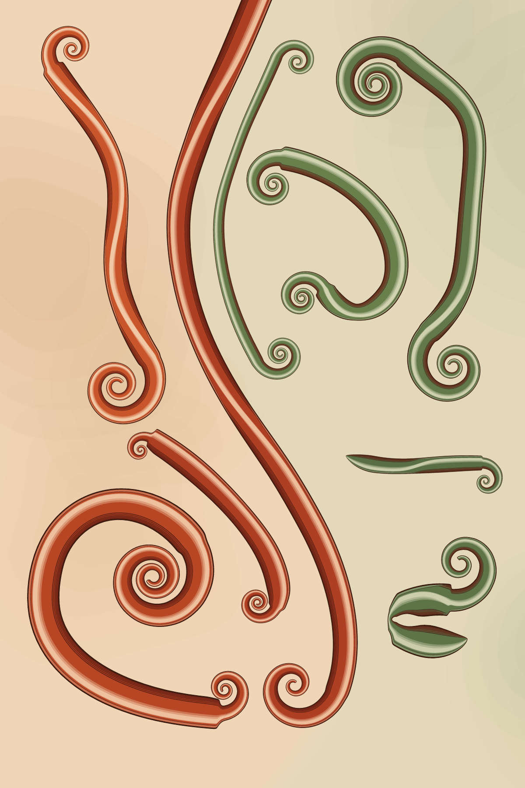
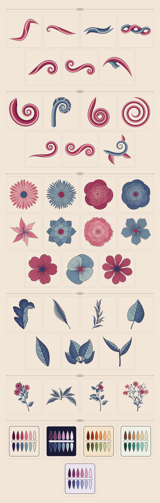

# orna

`orna` is a purely procedural, seed-based engine for Art Nouveau botanical illustrations. It draws ribbons, spirals, engraved flowers, foliage and plants from mathematical curves, decorates them with shape-aware hatching and stippling, composes them, and writes SVG and PNG. No images, models or training data are involved: a seed and a few parameters fully determine the artwork.

## Previews

| `botanica` (seed 42) | `bloom` (seed 7, `moonlit`) | `ribbons` (seed 3, `ember`) |
| --- | --- | --- |
|  |  |  |



The images in `previews/` come from these commands:

```shell
orna generate --seed 42 --preset botanica --single --output previews/botanica.png
orna generate --seed 7 --preset bloom --palette moonlit --single --output previews/bloom.png
orna generate --seed 3 --preset ribbons --palette ember --single --output previews/ribbons.png
orna gallery --seed 42 --width 1200 --single --output previews/gallery.png
```

## Architecture

Five layers, each depending only on the ones above it:

1. `src/geom/`: geometry: the `Curve` trait, spirals, ribbons, leaves, surfaces, curve fitting and validation.
2. `src/motif/`: drawable motifs built from geometry and ornament (ribbons, spirals, flowers, foliage, plants) that return scene nodes.
3. `src/ornament/`: shape-aware ornamentation (contours, hatching, stippling) in surface parameter space.
4. `src/compose/`: composition and procedural growth: vector fields, masks, placement, presets and the demonstration gallery.
5. `src/render/`: SVG export and PNG rasterisation (via `resvg`).

Built on `kurbo` (curves), `svg` (document), `resvg` (raster), `rand_chacha` (seeded streams), `noise` (fields), `palette` (Oklab colour mixing), `clap` (CLI) and `serde` (config).

Shared pieces: `src/scene/` (the scene graph: `Node`, `Scene`, `Style`, `Color`), `src/config.rs` (the serialisable `Config`), `src/palette.rs` (built-in palettes), `src/rng.rs` (`SeedTree` random streams).

## Command line

Run the binary with `pixi run cargo run --release -- <command>`, or use `target/release/orna` after `pixi run cargo build --release`.

### `orna gallery`

Renders a demonstration sheet: sections of ribbons, spirals, flowers, foliage, plants and one swatch per palette, laid out as a grid of square tiles. The column count follows from `--width` (tiles stay at least 240 units wide), sections without items are left out, and the sheet grows taller than `--height` when the tiles need it.

```sh
orna gallery --seed 42 --output out/gallery.svg
orna gallery --palette moonlit --width 800 --output out/moonlit.png --scale 2
orna gallery --output out/gallery.svg --single
```

| Flag | Default | Meaning |
| --- | --- | --- |
| `--seed <SEED>` | `42` | Master seed |
| `-o, --output <OUTPUT>` | `gallery.svg` | Output path ending in `.svg` or `.png`; missing directories are created |
| `--width <WIDTH>` | `1600` | Sheet width |
| `--height <HEIGHT>` | `2000` | Minimum sheet height |
| `--palette <PALETTE>` | `botanica` | Palette of the sheet (see `orna palettes`) |
| `--scale <SCALE>` | `1` | PNG scale factor relative to the SVG size |
| `--single` | off | Write only the format of `--output` |

Without `--single`, both `<name>.svg` and `<name>.png` are written next to each other. Each written path is printed. Tile groups carry SVG ids such as `flowers-daisy` or `palettes-ember`.

### `orna generate`

Generates a full artwork from a preset. The same config always gives byte-identical output.

```sh
orna generate --seed 1234 --preset botanica --output out/artwork.png
orna generate --seed 7 --preset bloom --palette moonlit --output out/bloom.svg
orna generate --seed 5 --save-config --output out/a.png
orna generate --config out/a.json --output out/again.png
```

| Flag | Default | Meaning |
| --- | --- | --- |
| `--seed <SEED>` | `42` | Master seed |
| `--preset <PRESET>` | `botanica` | `botanica`, `bloom` or `ribbons` |
| `-o, --output <OUTPUT>` | `artwork.png` | Output path ending in `.svg` or `.png`; missing directories are created |
| `--width <WIDTH>` | `1200` | Canvas width |
| `--height <HEIGHT>` | `1800` | Canvas height |
| `--palette <PALETTE>` | `botanica` | Palette name (see `orna palettes`) |
| `--detail <DETAIL>` | `1` | Detail multiplier in `(0, 10]`: scales the path budget (55 000 paths at 1), the amount of background foliage and the branching of plants |
| `--scale <SCALE>` | `1` | PNG scale factor relative to the SVG size |
| `--config <CONFIG>` | none | JSON config to load; flags given explicitly override its fields |
| `--save-config` | off | Also write the effective config as `<name>.json` |
| `--single` | off | Write only the format of `--output` |

Two options exist only in the JSON config: `opening` (default `true`) shows the moonlit opening of the botanica preset, and `density` (default `1`, range `[0, 4]`) multiplies the number of filler elements (background foliage, small flowers). Configs without them load with the defaults.

Presets:

- `botanica`: a poster split by an S-shaped divider band into a warm region (magenta, rose, plum) and a cool one (blue, sage, lavender); the warm side lands left or right by seed. Large focal flowers sit on collars of leaves at the centres of two counter-rotating vortices. Ribbons follow the longest streamlines of that field and roll into spiral tails, thin vines with leaves and small flowers follow the shorter ones, plants grow from the bottom edge, and dim background foliage fills the gaps that are left. A moonlit window (moon, stars, hills, framed by a wreath of leaves) opens in the upper cool region.
- `bloom`: one large flower of a random species on a collar of leaves and a leafy stem, between two scroll ribbons, one warm and one cool.
- `ribbons`: ribbons and spirals only: the divider band and ribbons along the field's streamlines, warm on one side of the divider and cool on the other.

### `orna palettes`

Lists the built-in palettes (`botanica`, `moonlit`, `ember`, `verdigris`, `plum-mist`) with their background, ink, warm and cool colours.

## Determinism

All randomness comes from `SeedTree` streams derived from the seed, so the same seed and options produce byte-identical SVG and PNG on every run. Different subsystems draw from independent streams, so changing one motif does not reshuffle the others.

## Development

The toolchain comes from pixi (`pixi.toml`); run every command through it:

```sh
pixi run cargo fmt
pixi run cargo clippy --all-targets -- -D warnings
pixi run cargo test
pixi run prek run --all-files
```

## Licence

See [LICENSE](LICENSE).
