# Option matrix (seed 7)

Every discrete combination of the `orna generate` flags at seed 7, rendered at 400×600 and shown at 320×480. Columns are the five palettes; each row is one set of flags. Reproduce a cell with:

```shell
orna generate --seed 7 <row flags> --palette <column> --width 400 --height 600 --single --output out/tile.png
```

| flags | `botanica` | `moonlit` | `ember` | `verdigris` | `plum-mist` |
| --- | --- | --- | --- | --- | --- |
| `--preset botanica` | 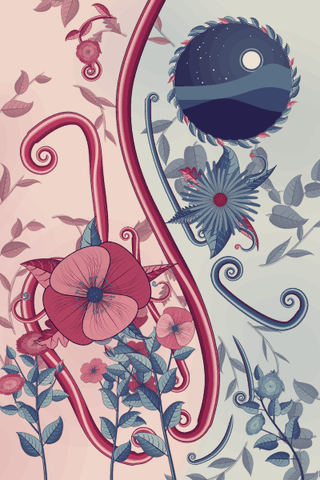 |  | 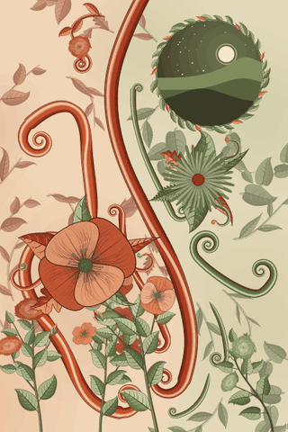 | 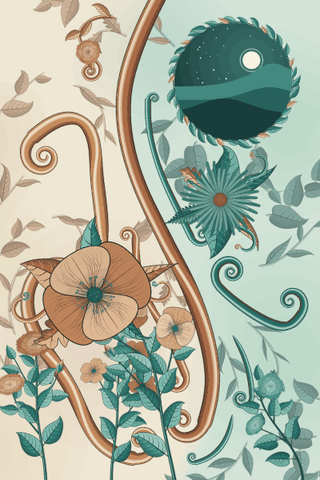 | 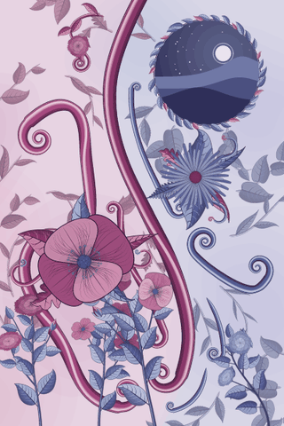 |
| `--preset botanica --no-opening` |  |  |  |  |  |
| `--preset botanica --density 2.5` | 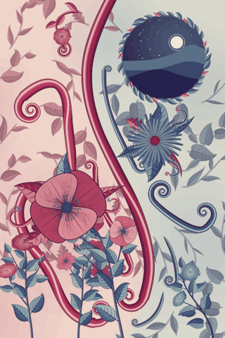 |  | 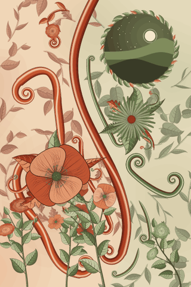 | 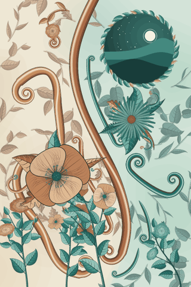 | 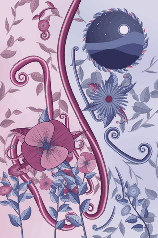 |
| `--preset botanica --no-opening --density 2.5` | 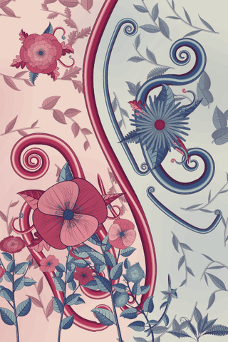 |  |  |  | 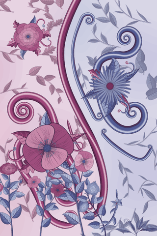 |
| `--preset bloom` |  |  |  |  |  |
| `--preset ribbons` |  |  |  | 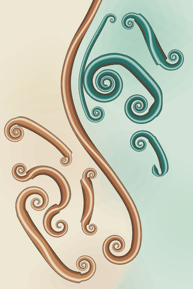 |  |

A palette changes only the colours; the composition for a given seed is identical across palettes. `--no-opening` removes the moonlit landscape entirely.

## Gallery with seed 7

## Galleries by palette (seed 7)

`orna gallery --seed 7 --palette <palette> --width 1200 --single --output out/gallery-<palette>.png`, shown at 800 px wide. The seed fixes every motif; only the colours change between columns.

| `botanica` | `moonlit` | `ember` | `verdigris` | `plum-mist` |
| --- | --- | --- | --- | --- |
| 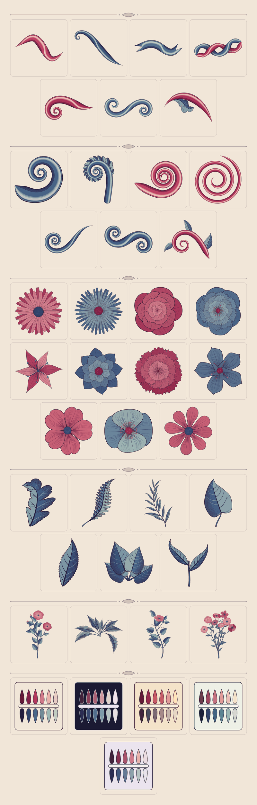 | 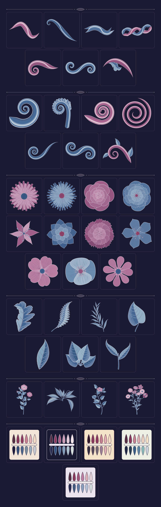 | 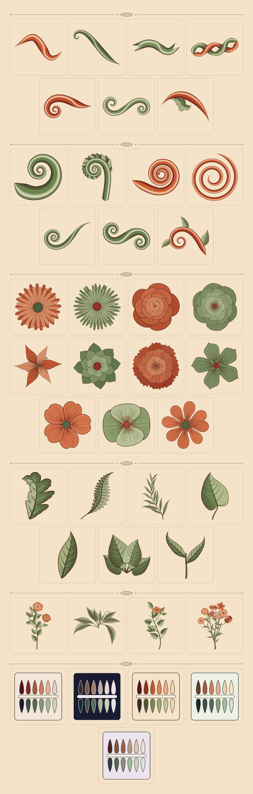 | 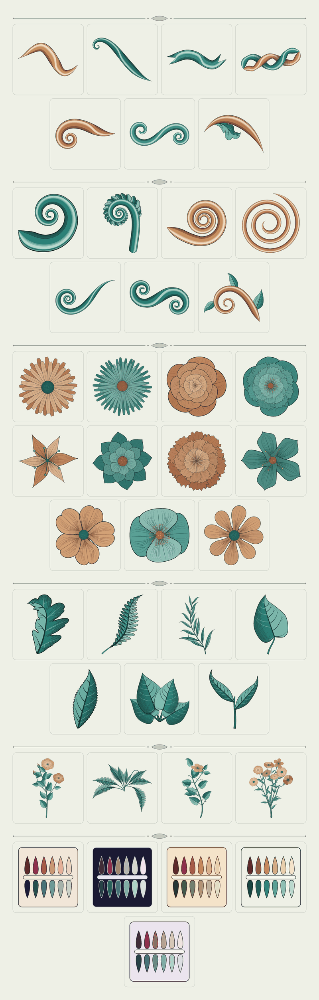 | 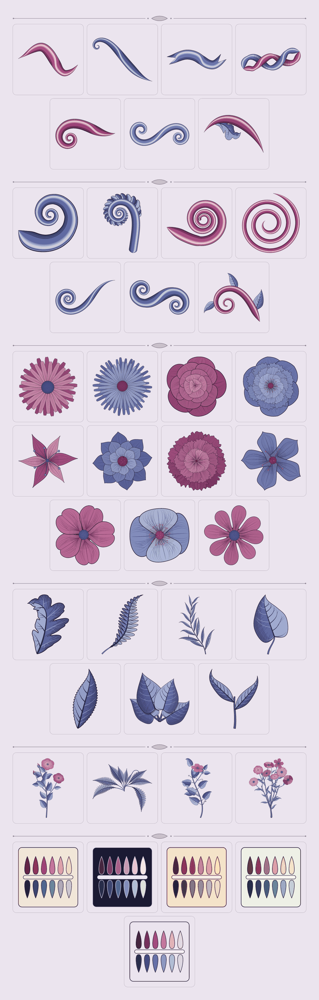 |
