# Option matrix (seed 7)

Every discrete combination of the `orna generate` flags at seed 7, rendered at 320×480. Columns are the six palettes; each row is one set of flags. Reproduce a cell with:

```shell
orna generate --seed 7 <row flags> --palette <column> --width 320 --height 480 --single --output out/tile.png
```

A palette changes only the colours; the composition for a given seed is identical across palettes. The tiles and gallery sheets here are reduced to 256 colours to keep the repository small; the renders themselves are full colour.

## `botanica`: landscape × background

`--landscape` paints the moonlit landscape openly across the cool region (`open`, default), inside a framed window (`window`), or not at all (`none`). `--background` fills the free space with overlapping scrolls, leaves and small flowers (`dense`, default), with a field of flowers of varied species and hues (`blooms`), or with sparse sprigs of leaves (`sprigs`).

| flags | `botanica` | `moonlit` | `ember` | `verdigris` | `plum-mist` | `nocturne` |
| --- | --- | --- | --- | --- | --- | --- |
| `--landscape open --background dense` |  |  | 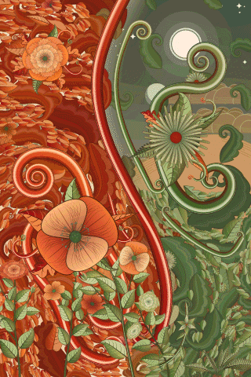 |  |  |  |
| `--landscape open --background blooms` |  |  |  | 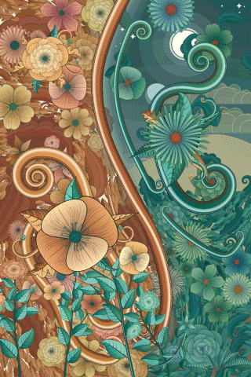 |  |  |
| `--landscape open --background sprigs` | 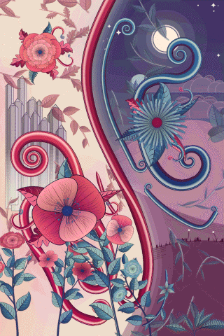 | 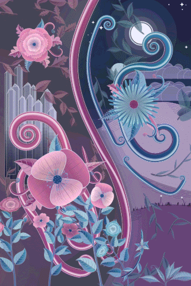 | 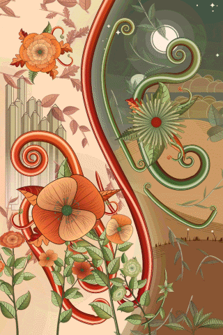 | 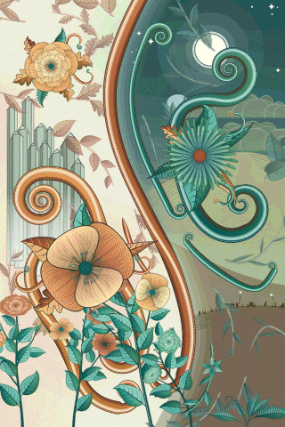 | 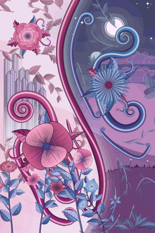 |  |
| `--landscape window --background dense` | 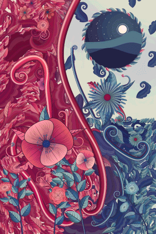 | 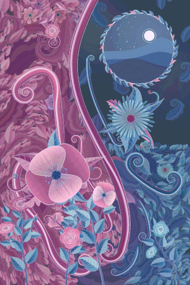 | 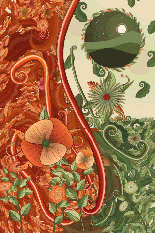 | 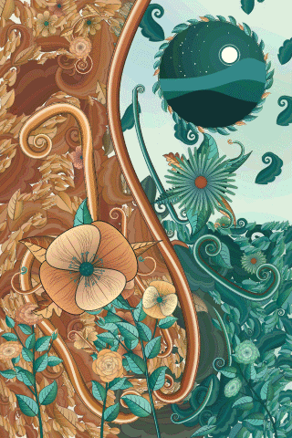 | 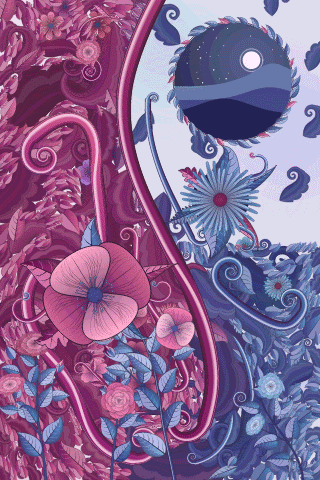 |  |
| `--landscape window --background blooms` |  |  | 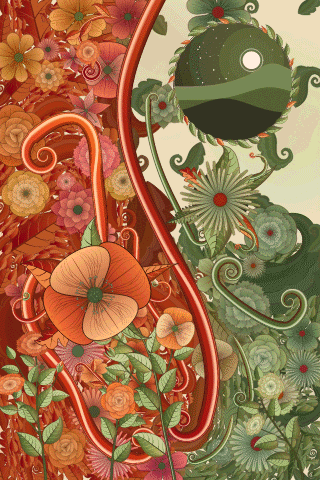 |  |  |  |
| `--landscape window --background sprigs` | 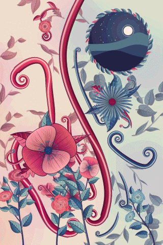 | 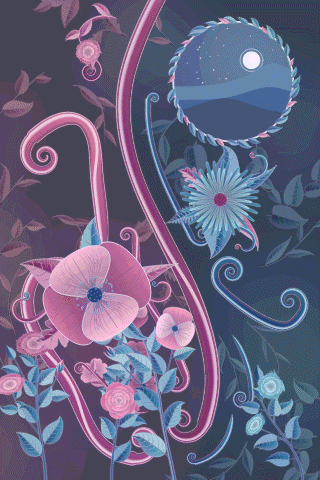 | 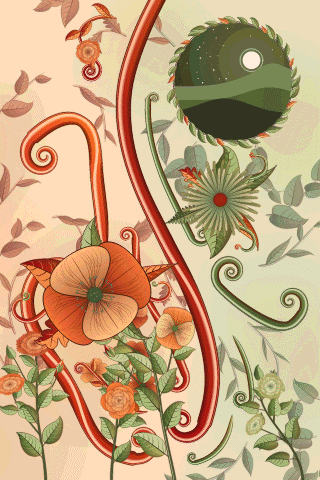 | 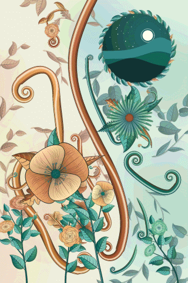 | 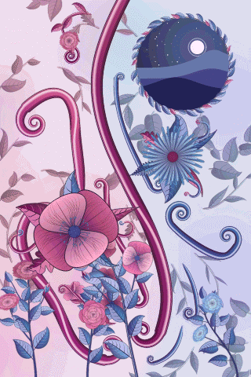 |  |
| `--landscape none --background dense` |  |  |  |  | 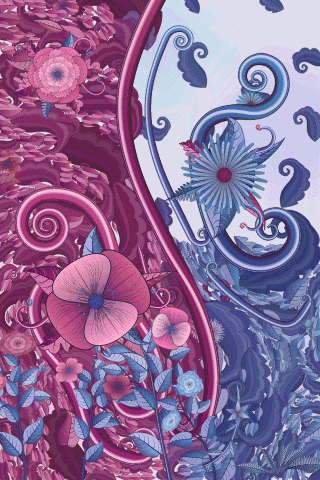 |  |
| `--landscape none --background blooms` |  |  |  |  | 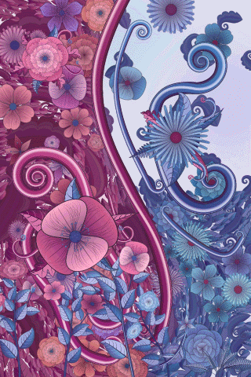 |  |
| `--landscape none --background sprigs` |  | 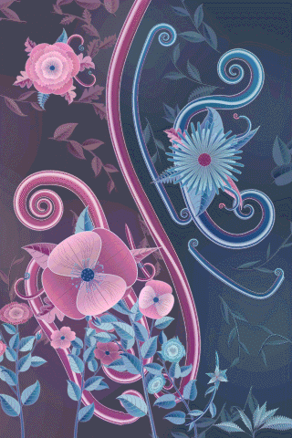 |  |  |  |  |

## Density and the other presets

`--density` multiplies the number of filler elements (background ornament, vine flowers, plant branching); `bloom` and `ribbons` ignore the landscape and background flags.

| flags | `botanica` | `moonlit` | `ember` | `verdigris` | `plum-mist` | `nocturne` |
| --- | --- | --- | --- | --- | --- | --- |
| `--preset botanica --density 2.5` |  | 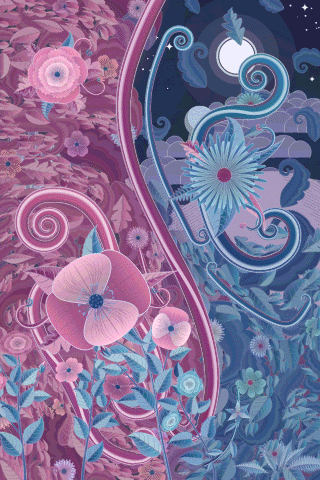 | 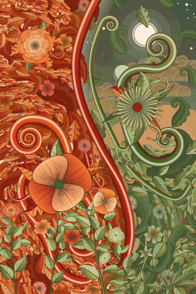 | 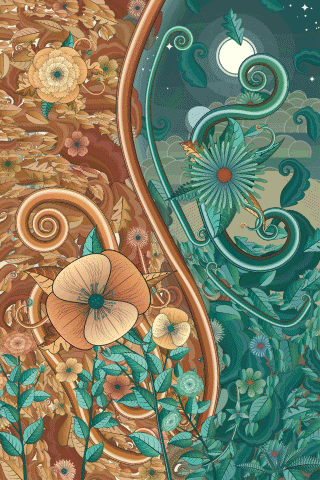 |  | 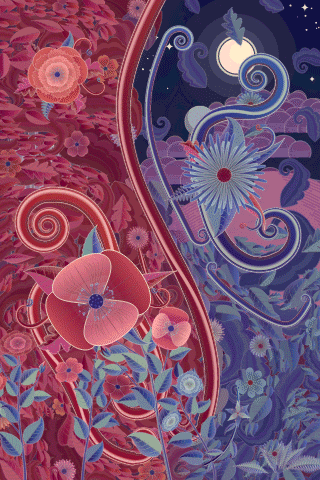 |
| `--preset bloom` |  |  |  |  |  |  |
| `--preset ribbons` |  |  |  |  |  |  |

## Galleries by palette (seed 7)

`orna gallery --seed 7 --palette <palette> --width 800 --single --output out/gallery-<palette>.png`. The seed fixes every motif; only the colours change between columns. Sections: ribbons, spirals, scrolls, flowers, foliage, plants, palette swatches.

| `botanica` | `moonlit` | `ember` | `verdigris` | `plum-mist` | `nocturne` |
| --- | --- | --- | --- | --- | --- |
|  |  |  |  |  | 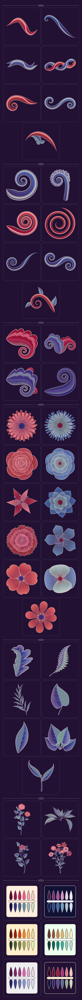 |
